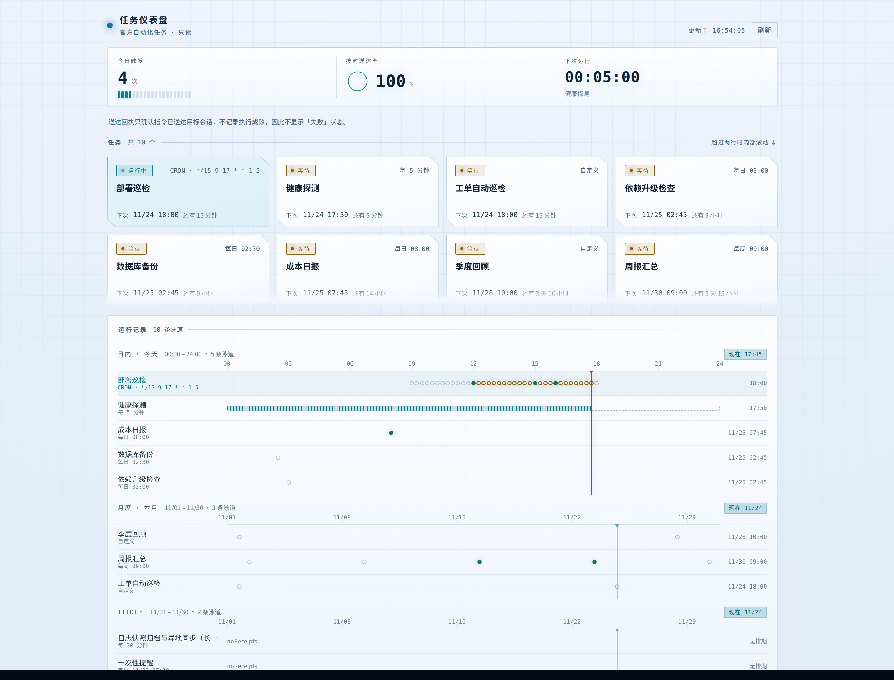
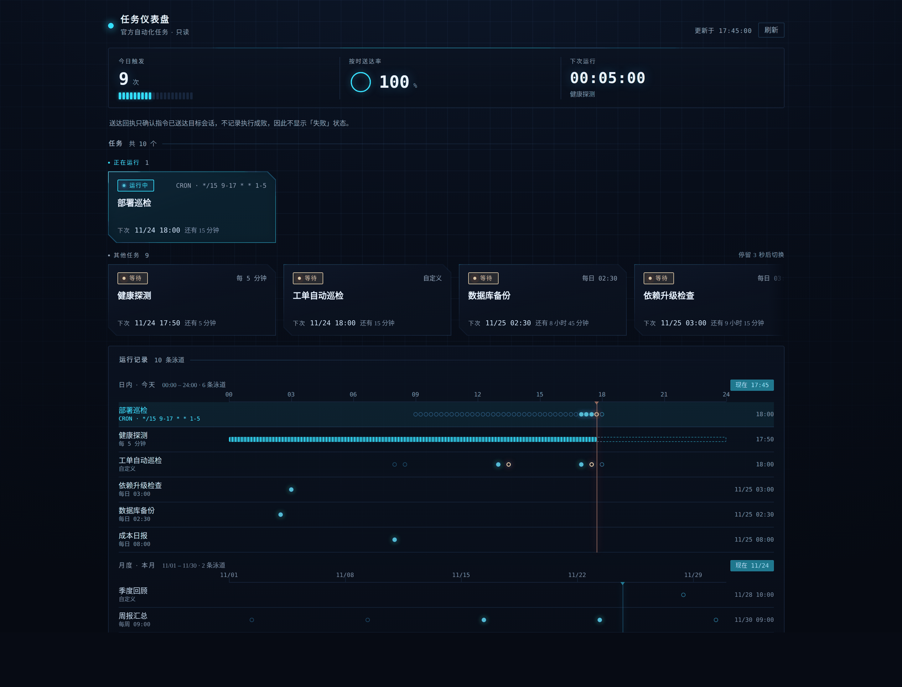

# 任务看板（@carloskey/dsh-automation-dashboard）

[English](README.md) | 中文





<sub>截图为示例数据下的真实组件渲染，不是运行中页面的实拍。</sub>

一个**只读**的自动化任务看板：新增一个左侧栏入口和它自己的主面板，不改动、不替换、不禁用官方「自动化任务」页的任何注册与功能。所有数据都来自官方 schedule 服务的既有接口，不新建任务存储。

## 挂载位置

| 位置 | 注册 | 与官方页面的关系 |
|:--|:--|:--|
| 左侧栏图标 | `sidebar.panellist`，id `automation-dashboard`，order 20 | 官方 `schedules` 仍在 order 10，两个入口并存 |
| 主面板 | `main`，key `automation-dashboard` | 官方页面占用 `main · schedules`，互不覆盖 |
| Host 半 | 空 `apply`，不注册任何服务 | 只读官方 RPC |

## 数据来源

| 官方 RPC | 用途 |
|:--|:--|
| `schedule/catalog` | 任务名、规则、状态、下次排期、`executionActive`、最近一次回执 |
| `schedule/history` | 每个任务最近 100 条送达回执（最多取 16 个任务） |
| `schedule/changed` | 目录变更时刷新（350ms 合并），另有 60 秒兜底轮询 |

入口本身挂在 `schedule/catalog` 的访问控制下：没有该权限的 Peer 看不到入口，而不是看到一个报错的页面。

## 页面显示什么

- **统计条**：今日触发（分段刻度，目录超过 16 个任务时显示 `≥N`）、按时送达率（细线环）、下次运行倒计时（等宽，每秒跳动）。
- **任务卡片**：固定两行，不再纵向滚动。第一行只放「正在运行」的任务，第二行放其余全部；一个任务只在一行里，所以状态变化表现为一张卡在行与行之间移动，而不是一处出现、另一处消失。某行的卡片超出可视宽度时，停 3 秒、横向移动一张、循环播放——屏幕上的卡片会在末尾重复一份，因此回绕没有可见接缝。行内有键盘焦点时暂停，装得下的行不动。切角玻璃面板，状态光点 + 规则 + 下次时间。正在执行的任务整框发蓝，结束后恢复。
- **运行记录**：每个任务一条横向泳道，按规则分窗口——日内/每日走「今天 00:00–24:00」，每周/RRULE 走「本月」，一次性任务锚在它自己那天。扫描线是「现在」，青色呼吸，越过执行点后转红 60 秒。点越过扫描线时变色：未到点空心、正在执行青色、拿到回执翠绿、过点无回执琥珀、超出回执保留期暗灰「未确认」。
- **推算而非读取**：Host 只存每个任务的下一次执行，未来点由已存规则推算（cron、daily、weekly、every，以及 `FREQ=DAILY|WEEKLY|MONTHLY|YEARLY` 加 `INTERVAL`/`BYDAY`/`BYHOUR`/`BYMINUTE`/`BYMONTHDAY`/`BYMONTH`/`UNTIL` 的 RRULE 子集）。`COUNT`、`BYSETPOS`、`BYWEEKNO`、`BYYEARDAY`、带序号的 `BYDAY` 等不猜，只显示官方那一次。
- **暂停/结束的任务**只画真实回执，收进最底部「无排期」组。
- **主题**：浅色为基底，祖先带 `data-ds-dark-theme` 时整页切深色；状态色语义一致，浅色下加深，发光减弱。

## 交互

- 点**任务卡片** → 打开官方「自动化任务」页（任务定义所在）。
- 点**泳道** → 打开该任务绑定的会话（`target.sessionId`；`new` 目标取最近一次送达的会话）。
- 键盘可聚焦，Enter / 空格等价于点按。

## 安装

需要 DSH `>= 0.2.2-rc.3`（在 `0.2.2-rc.5` 上验证）。

**推荐：在 GUI 里装。** 打开 **插件 → 添加插件**，粘贴
`github:carloskey/dsh-automation-dashboard` 并确认；如果装完是未启用状态，
在插件列表里把它启用。这一条流程会同时完成「装包」和「加入 bundle 层」，
不需要再改任何文件。装完刷新一次页面。

**命令行安装：** `dsh plugin` 只是 pnpm 的直通，还得自己把包名加进 bundle 列表：

```sh
dsh plugin --profile web add github:carloskey/dsh-automation-dashboard
# 再把 "@carloskey/dsh-automation-dashboard" 追加到
# ~/.dsh/profiles/web/package.json 的 dsh.profile.bundles
```

没有构建步骤、没有依赖、没有安装脚本。

## 已知限制

- 未来执行点是**推算**的，不是官方数据；与 Host 的调度在时区、夏令时边界上可能有秒级差异。
- 回执只保留 30 天 / 每任务 200 条，更早的点显示「未确认」而不是「逾期」。
- 一个任务超过 120 个点时合并成密度带，不再逐点绘制。
- 点卡片只能打开管理页，无法定位到具体那一条（官方页没有暴露按 id 选中的接口）。

## 开发

```sh
npm run check   # 语法检查
npm test        # 无头渲染测试（不依赖浏览器）
```

CI 跑 `check`、`test` 和 `npm pack --dry-run`。

## 许可证

MIT
